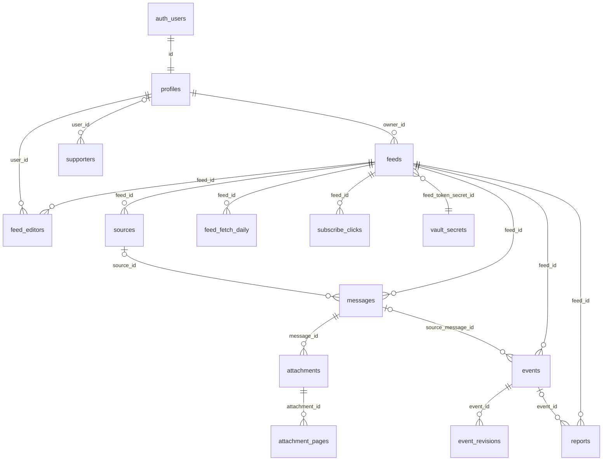

# Data model

Status: Phase 5. The source of truth is `supabase/migrations/`. This page explains it; if they ever disagree, the migrations win, and this page should be fixed.

## Diagram

Not linked to anything: `jobs_dedupe`, `zip_codes`, and `private.fetch_salts` (one random salt per day for fetch hashing; kept 2 days; no API access). `feeds.feed_token_secret_id` points into `vault.secrets`, with no foreign key; a trigger keeps them in step.

## Who can do what

"Member" means a row in `feed_editors` for that feed, with role `owner` or `editor`. Every table has RLS on (a pgTAP test checks every table in `public`). Supabase's default grants are revoked; each role gets only the privileges listed here. The service role bypasses RLS and is used only by server-side jobs.

| Table | anon | signed-in member | signed-in non-member | service role only |
|---|---|---|---|---|
| profiles | — | own row: read, change display name | — | |
| feeds | public feeds, public-safe columns | read (no token columns); owner updates and deletes | creates own feeds | token columns |
| feed_editors | — | read; owner adds and removes editors | — | |
| sources | — | read, add, change, delete | — | |
| messages | — | read, delete | — | writes |
| attachments | — | read; change `chosen` | — | writes |
| attachment_pages | — | read | — | writes |
| events | published events of public feeds, no evidence columns | read, add, change, delete | — | |
| event_revisions | — | read | — | writes |
| reports | — | read; change `status` | — | inserts |
| feed_fetch_daily, subscribe_clicks, jobs_dedupe, supporters | — | — | — | everything |
| zip_codes | read | read | read | writes |

Signed-in non-members don't read public feeds from the tables. Public pages go through `public_feed_page()`, so the evidence quote and confidence of an event are never visible outside its feed's members.

## Tables

**profiles.** One per signed-in user, same id as `auth.users`. A trigger on `auth.users` creates it at signup, taking the display name from the Google profile when there is one. `deleted_at` marks an account in its deletion grace period.

**feeds.** A calendar feed.
- `slug` is lowercase letters, digits and hyphens, at most 80 characters, unique.
- An **unlisted** feed's slug gets `-` plus 8 random characters from `[a-z0-9]` when it's created, when it becomes unlisted, and when its slug changes while unlisted [Rev 3].
- `visibility` is `public`, `unlisted` or `private`. New feeds default to `private`.
- `owner_id` defaults to the signed-in user. Nobody can set it directly.
- `feed_token_hash` is the SHA-256 of the feed token. `feed_token_secret_id` is the Vault secret holding the token itself [Rev 1]. A trigger sets both on insert.
- `search` is generated from name (weight A), description (B) and category (C), with a GIN index.
- `location` is a PostGIS point (SRID 4326), with a GiST index.
- `last_updated_at` is bumped by any change to the feed's events.
- `intake_address` is filled in Phase 6.

**feed_editors.** Members of a feed. A trigger adds the owner as the `owner` row when the feed is created. There can be only one owner row per feed, and it can't be added or removed through the API.

**sources.** Senders a feed trusts. `attachment_rule` (jsonb) holds the learned "which attachment has the schedule" pattern (Phase 8). Each sender email is unique per feed, ignoring case.

**messages.** Forwarded emails. They're unique per `(feed_id, message_id_header)`, so the same email arriving twice is stored once. `expires_at` defaults to 30 days after insert. Status values: `received`, `parsed`, `extracted`, `needs_review`, `ignored`, `failed`.

**attachments.** Files on a message. `chosen` is the "This one has the schedule" flag. Status values: `pending`, `skipped`, `text_layer`, `transcribed`, `failed`.

**attachment_pages [Rev 2].** One row per page. `text` holds either the PDF text layer (`text_source = text_layer`) or the vision model's verbatim transcription (`transcription`). Phase 9 checks evidence quotes against this text. `image_path` is the page image shown next to the quote on the review card.

**events.**
- `uid` is generated as `<id>@feedcal.app` and never changes.
- `timezone` must be a name in `pg_timezone_names`; a trigger rejects anything else.
- `ends_at` must not be before `starts_at`.
- `updated_at` is set on every update.
- `sequence` rises automatically on any change a subscriber can see (`private.events_bump_sequence`, D24).
- `published = false` events are drafts, visible only to members.

**event_revisions.** One row per change. `cause` is one of `extracted`, `matched_update`, `manual_edit`, `cancelled`, `restored`. `actor` is `ai`, `system` or `user:<uuid>`.

**reports.** "Report a problem" from subscribers. These are inserted server-side, with rate limits, in Phase 12/14. Members read them and set `status`.

**feed_fetch_daily.** One row per feed, per day, per client. `client_hash` is a hash of IP + user agent + a daily salt, never the raw IP (Phase 4).

**subscribe_clicks [Rev 4].** Taps on each subscribe button per feed per day. Platform values: `apple`, `google`, `outlook`, `copy_link`, `other`.

**jobs_dedupe.** Idempotency keys for jobs and webhooks (rule 8).

**supporters.** Buy Me a Coffee supporters (Phase 15).

**zip_codes.** Zip code to point, loaded in Phase 13.

Status changes on `events`, `messages`, `attachments` and `reports` are limited to the moves in docs/STATE-MACHINES.md (enforced by a trigger).

## Functions

| Function | Who can call | What it does |
|---|---|---|
| `public_feed_page(p_slug, p_limit = 50)` [Rev 3] | anon, signed-in | Returns JSON `{feed, events}` when the slug matches **exactly** and the feed is public or unlisted; otherwise `null`. Events: published, not cancelled, not yet ended, oldest first, 1–200 (default 50). `subscribers_at_least` counts distinct clients in `feed_fetch_daily` over the last 7 days [Rev 4]. Since Phase 5 it also returns `feed_token` (the subscription token) and `area` (from `zip_codes`); see D23 for why the token is returned. Never returns the token hash, intake address, owner id or evidence fields. |
| `record_subscribe_click(p_slug, p_platform)` [Rev 4] | anon, signed-in | Phase 5. Adds 1 to today's `subscribe_clicks` row for a public or unlisted feed. Platform is `apple`, `google`, `outlook`, `copy_link` or `other`. Returns whether it counted. No personal data. |
| `feed_subscribe_stats(p_feed_id)` | signed-in members | Phase 5. `{subscribers_at_least, clicks_30d: {platform: n}}`; `null` for non-members. |
| `get_feed_token(p_feed_id)` [Rev 1] | signed-in members | Returns the current token from Vault. Anyone else gets error `42501`. |
| `rotate_feed_token(p_feed_id)` [Rev 1] | signed-in owner | Makes a new token, overwrites the hash and the Vault copy, and returns the new token. The old link stops matching. |
| `feed_calendar(p_token, p_client_ip, p_user_agent, p_ua_family)` | anon, signed-in | Phase 4. Looks the feed up by `sha256(token)`; returns `null` for an unknown or malformed token. Returns the feed's public fields and its published events, plus events cancelled in the last 30 days (so calendars remove them). Each event's `source` is the sender's domain only. Records one `feed_fetch_daily` row per client per day, as `sha256(daily salt ‖ IP ‖ user agent)`; the raw IP and user agent are never stored. |
| `state_machines()` | anon, signed-in | Every legal status move (D24). No user data. Source for `npm run db:states`. |
| `account_status()` | signed-in user | `{state: active or scheduled_for_deletion, deletion_requested_at, deletes_on, grace_days}`. |
| `health_check()` | anon, signed-in | Returns `true` (Phase 1). |
| `request_account_deletion()` / `cancel_account_deletion()` | signed-in user, for themselves | Sets or clears `profiles.deleted_at`. Returns the deletion date (14 days out). |
| `due_account_deletions()` | service role | Lists accounts whose 14 days have passed. |
| `purge_account_data(p_user_id)` | service role | Hands each owned feed to its longest-standing editor, or deletes it if there is none. Removes the user from all feeds, replaces `user:<id>` revision actors with `system`, and wipes the display name. Safe to run twice. |
| `private.*` | used inside policies and triggers | Not exposed by the API (the `private` schema isn't in the API's exposed schemas). |

Tokens are 43 characters, URL-safe base64 of 32 random bytes from `pgcrypto`. The hash is Postgres's built-in `sha256()` of the UTF-8 token.

## Things to know when writing app code

- Signed-in users can't `select *` from `feeds` or `events`: some columns aren't granted. List the columns you need.
- Generated types (`packages/shared/src/database.types.ts`) show `feed_token_hash` and `feed_token_secret_id` as required on insert, because they are NOT NULL. A trigger sets them, and the API refuses them anyway; leave them out of inserts.
- `public_feed_page` returns JSON. Validate it with Zod in the web app (rule 3).

## Known gaps (Phase 2)

- **Recurring events.** `public_feed_page` filters by `starts_at`/`ends_at`. A recurring event whose first date has passed is left out even if later dates are upcoming. Phase 4/5 should handle this when RRULE expansion exists.
- **Repeat suffixes.** A feed that goes unlisted, then private, then unlisted again gets a second suffix. The base is cut to 71 characters first, so the slug stays within 80.
- **Editors and visibility.** Only owners can change feed settings, including visibility. Editors manage events and sources.
- **Vault on hosted Supabase.** Only the local stack has been checked: there, the `postgres` role can create, update, read and delete Vault secrets. Whether hosted Supabase allows the same is `UNVERIFIED`; it gets checked on the first staging deploy.
