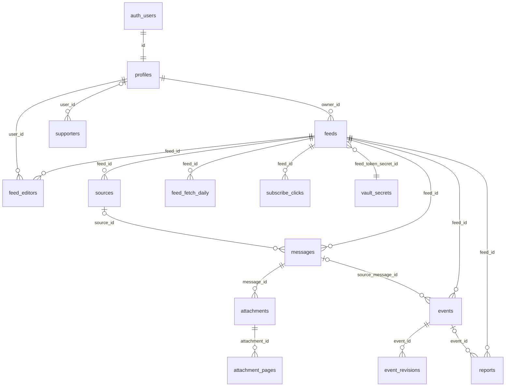

# Data model

Status: Phase 5. The source of truth is `supabase/migrations/`. This page explains it; if they ever disagree, the migrations win, and this page should be fixed.

## Diagram

Not linked to anything: `jobs_dedupe`, `zip_codes`, and `private.fetch_salts` (one random salt per day for fetch hashing; kept 2 days; no API access). `feeds.feed_token_secret_id` points into `vault.secrets`, with no foreign key; a trigger keeps them in step.

## Who can do what

"Member" means a row in `feed_editors` for that feed, with role `owner` or `editor`. Every table has RLS on (a pgTAP test checks every table in `public`). Supabase's default grants are revoked; each role gets only the privileges listed here. The service role bypasses RLS and is used only by server-side jobs.

| Table | anon | signed-in member | signed-in non-member | service role only |
|---|---|---|---|---|
| profiles | — | own row: read, change display name | — | |
| feeds | public feeds, public-safe columns | read (no token columns); owner updates and deletes | creates own feeds | token columns |
| feed_editors | — | read; owner adds and removes editors | — | |
| sources | — | read, add, change, delete | — | |
| messages | — | read, delete | — | writes |
| attachments | — | read; change `chosen` | — | writes |
| attachment_pages | — | read | — | writes |
| events | published events of public feeds, no evidence columns | read, add, change, delete | — | |
| event_revisions | — | read | — | writes |
| reports | — | read; change `status` | — | inserts |
| feed_fetch_daily, subscribe_clicks, jobs_dedupe, supporters | — | — | — | everything |
| zip_codes | read | read | read | writes |

Signed-in non-members don't read public feeds from the tables. Public pages go through `public_feed_page()`, so the evidence quote and confidence of an event are never visible outside its feed's members.

## Tables

**profiles.** One per signed-in user, same id as `auth.users`. A trigger on `auth.users` creates it at signup, taking the display name from the Google profile when there is one. `deleted_at` marks an account in its deletion grace period.

**feeds.** A calendar feed.
- `slug` is lowercase letters, digits and hyphens, at most 80 characters, unique.
- An **unlisted** feed's slug gets `-` plus 8 random characters from `[a-z0-9]` when it's created, when it becomes unlisted, and when its slug changes while unlisted [Rev 3].
- `visibility` is `public`, `unlisted` or `private`. New feeds default to `private`.
- `owner_id` defaults to the signed-in user. Nobody can set it directly.
- `feed_token_hash` is the SHA-256 of the feed token. `feed_token_secret_id` is the Vault secret holding the token itself [Rev 1]. A trigger sets both on insert.
- `search` is generated from name (weight A), description (B) and category (C), with a GIN index.
- `location` is a PostGIS point (SRID 4326), with a GiST index.
- `last_updated_at` is bumped by any change to the feed's events.
- `intake_address` is the local part of the feed's forwarding address, `feed-` plus 20 random base32 characters (100 bits). A trigger sets it on insert; only `rotate_intake_address` changes it. Visible to members only.

**feed_editors.** Members of a feed. A trigger adds the owner as the `owner` row when the feed is created. There can be only one owner row per feed, and it can't be added or removed through the API.

**sources.** Senders seen by a feed. `trusted` and `blocked` change only through `decide_sender` (Phase 6). `attachment_rule` (jsonb) holds the learned "which attachment has the schedule" pattern (Phase 8). Each sender email is unique per feed, ignoring case.

**messages.** Forwarded emails. They're unique per `(feed_id, message_id_header)` and per `(feed_id, sha256)` (sha256 of the body, below the headers), so the same email arriving twice is stored once. Phase 6 adds `raw_bytes`, `attachment_count`, `auth_spf`/`auth_dkim`/`auth_dmarc` (from Cloudflare's header), and `quarantine_reason` (`new_sender` or `failed_authentication`; null once decided). Deleting a message queues its raw file for deletion. `expires_at` defaults to 30 days after insert. Status values: `received`, `parsed`, `extracted`, `needs_review`, `ignored`, `failed`.

**forwarding_confirmations.** Gmail's forwarding confirmation codes, shown on the email setup page for 7 days. The link must be on `mail-settings.google.com` or `mail.google.com`. Members can read; only `ingest_commit` writes.

**private.ingest_tickets / private.storage_trash / private.app_settings.** One-time upload tickets; files waiting for deletion through the Storage API; where pg_cron finds the Edge Functions. Not reachable through the API.

**messages (Phase 7 columns).** `reference_date` (the original's sent date, used to read "this Friday") and `reference_date_source`; `original_sender` and `original_subject` (from the innermost forward); `clean_text` (what the AI will read); `stripped_text` (quoted replies and signatures, kept as evidence, never sent to the AI); `language`; `parse_details` (forward notes, depth, body source, discarded images); `parsed_at`; `parse_attempts`.

**event_candidates (Phase 9).** One row per event the AI found and every check passed: times in UTC plus the zone, `change_kind` (new/changed/cancelled), `confidence`, the `evidence_quote` and where it came from (body, or attachment + page), `from_transcription` (the review card then shows the page image), and `review_reasons`. `state` goes pending → applied / needs_review / rejected in Phase 10. Members can read. Rejected AI output is listed in `messages.extraction.rejected`, with the reason.

**events (Phase 10 columns).** `exdates` (starts of single occurrences removed from a series; written as EXDATE and covered by SEQUENCE) and `source_thread` (the normalised subject of the email it came from). `event_candidates` gains `outcome` (new / update / cancel / exdate / duplicate / conflict / unmatched_change), `match_score` and `decided_at`.

**feeds.timezone (Phase 9).** The feed's default zone for reading "Friday at 6 PM" (default America/Los_Angeles).

**attachments.** Files on a message. Phase 8 adds `triage` (stage reached, reason, kept pages, page scores, vision cost estimate) and `triaged_at`; members can read the files through signed URLs (storage policy `attachments_member_read`). Phase 7 adds `inline`, `content_id`, `width`, `height`; files live in the private `attachments` bucket at `<feed>/<message>/<sha256>`; one row per distinct file per message. `chosen` is the "This one has the schedule" flag. Status values: `pending`, `skipped`, `text_layer`, `transcribed`, `failed`.

**attachment_pages [Rev 2].** One row per page. `text` holds either the PDF text layer (`text_source = text_layer`) or the vision model's verbatim transcription (`transcription`). Phase 9 checks evidence quotes against this text. `image_path` is the page image shown next to the quote on the review card.

**events.**
- `uid` is generated as `<id>@feedcal.app` and never changes.
- `timezone` must be a name in `pg_timezone_names`; a trigger rejects anything else.
- `ends_at` must not be before `starts_at`.
- `updated_at` is set on every update.
- `sequence` rises automatically on any change a subscriber can see (`private.events_bump_sequence`, D24).
- `published = false` events are drafts, visible only to members.

**event_revisions.** One row per change. `cause` is one of `extracted`, `matched_update`, `manual_edit`, `cancelled`, `restored`. `actor` is `ai`, `system` or `user:<uuid>`.

**reports.** "Report a problem" from subscribers. These are inserted server-side, with rate limits, in Phase 12/14. Members read them and set `status`.

**feed_fetch_daily.** One row per feed, per day, per client. `client_hash` is a hash of IP + user agent + a daily salt, never the raw IP (Phase 4).

**subscribe_clicks [Rev 4].** Taps on each subscribe button per feed per day. Platform values: `apple`, `google`, `outlook`, `copy_link`, `other`.

**jobs_dedupe.** Idempotency keys for jobs and webhooks (rule 8).

**supporters.** Buy Me a Coffee supporters (Phase 15, D36). Keyed by `supporter_hash`, the SHA-256 of the lower-cased email; the email itself isn't stored. Also holds the name given to BMC, the donation count, `total_cents` (integer) and currency, and whether they're a member. `user_id` is set only when the person links their account; `list_publicly` is their choice. No direct access for anon or signed-in users. `profiles.supporter_since` is the badge. Each webhook delivery is in `private.bmc_events`, keyed by BMC's `event_id`, so it counts once.

**Where personal data lives (D37).** The privacy page's retention list comes from this table.

| Data | Where | Kept | How deletion reaches it |
|---|---|---|---|
| Email address, sign-in history | `auth.users`, `auth.sessions` | Until the account is deleted | `delete-accounts` (daily, 14 days after the request) |
| Name, settings | `profiles`, `notification_settings` | Same | Purge, then cascade |
| Calendars, events, senders | `feeds`, `events`, `sources`, `feed_editors`, `event_revisions` | Same; cancelled events show in feeds for 30 days | Purge: feeds go to a co-editor or are deleted; revision actors become "system" |
| Forwarded emails and attachments | `messages`, `attachments`, `attachment_pages`, Storage `inbound-raw` | 30 days (`expires_at`; daily `expire_intake` plus `storage-trash`) | Expiry, or with the feed |
| Undo records | `undo_log` | 1 day | Purge job |
| Sign-in and rate-limit records | `private.login_attempts`, `private.report_limits`, `private.rate_hits` | 1 hour (salted hashes) | Deleted on use and hourly |
| Calendar fetch counts | `feed_fetch_daily` | 400 days (hash, with a daily salt kept 2 days) | `private.apply_retention` daily |
| Emails we sent | `private.email_outbox` | Contents 30 days after sending; the row stays so a once-only email isn't repeated | `apply_retention`; cascade on account delete |
| Supporter (donation) record | `supporters` | Until the account is deleted, if linked; otherwise kept (an email hash and the name given to BMC) | Purge deletes a linked record |
| Reports about feeds | `feed_reports`, `reports` | Kept for moderation | With the feed |
| Admin actions | `admin_audit` | Kept | The admin's id becomes null on account delete |
| Backups | GitHub artifacts, encrypted | 7 days daily, 90 days weekly | Age out |
| Logs | Cloudflare, Supabase | Their platform defaults (UNVERIFIED) | No emails or tokens are logged |

**rate_hits.** Phase 16 rate limiter: bucket, salted hash of the client address, time. Cleared hourly.

**zip_codes.** Zip code to point, loaded in Phase 13.

Status changes on `events`, `messages`, `attachments` and `reports` are limited to the moves in docs/STATE-MACHINES.md (enforced by a trigger).

## Functions

| Function | Who can call | What it does |
|---|---|---|
| `public_feed_page(p_slug, p_limit = 50)` [Rev 3] | anon, signed-in | Returns JSON `{feed, events}` when the slug matches **exactly** and the feed is public or unlisted; otherwise `null`. Events: published, not cancelled, not yet ended, oldest first, 1–200 (default 50). `subscribers_at_least` counts distinct clients in `feed_fetch_daily` over the last 7 days [Rev 4]. Since Phase 5 it also returns `feed_token` (the subscription token) and `area` (from `zip_codes`); see D23 for why the token is returned. Never returns the token hash, intake address, owner id or evidence fields. |
| `record_subscribe_click(p_slug, p_platform)` [Rev 4] | anon, signed-in | Phase 5. Adds 1 to today's `subscribe_clicks` row for a public or unlisted feed. Platform is `apple`, `google`, `outlook`, `copy_link` or `other`. Returns whether it counted. No personal data. |
| `feed_subscribe_stats(p_feed_id)` | signed-in members | Phase 5. `{subscribers_at_least, clicks_30d: {platform: n}}`; `null` for non-members. |
| `get_feed_token(p_feed_id)` [Rev 1] | signed-in members | Returns the current token from Vault. Anyone else gets error `42501`. |
| `rotate_feed_token(p_feed_id)` [Rev 1] | signed-in owner | Makes a new token, overwrites the hash and the Vault copy, and returns the new token. The old link stops matching. |
| `feed_calendar(p_token, p_client_ip, p_user_agent, p_ua_family)` | anon, signed-in | Phase 4. Looks the feed up by `sha256(token)`; returns `null` for an unknown or malformed token. Returns the feed's public fields and its published events, plus events cancelled in the last 30 days (so calendars remove them). Each event's `source` is the sender's domain only. Records one `feed_fetch_daily` row per client per day, as `sha256(daily salt ‖ IP ‖ user agent)`; the raw IP and user agent are never stored. |
| `state_machines()` | anon, signed-in | Every legal status move (D24). No user data. Source for `npm run db:states`. |
| `account_status()` | signed-in user | `{state: active or scheduled_for_deletion, deletion_requested_at, deletes_on, grace_days}`. |
| `health_check()` | anon, signed-in | Returns `true` (Phase 1). |
| `login_attempt_allowed(p_email, p_client_ip)` | anon, signed-in | D25. Records a sign-in email attempt; false over 5/address or 20/IP per hour. Hashes only. |
| `ingest_start(p_local_part, p_bytes)` / `ingest_commit(...)` | service role | Phase 6 (D26). Ticket, then dedupe, allowlist, quarantine, Gmail code, enqueue on `process_message`. Commit is safe to repeat. |
| `decide_sender(p_source_id, p_trust)` / `decide_message(p_message_id, p_release)` | signed-in members | Phase 6. Approve or decline a waiting sender (or one message). Approving queues its waiting mail. |
| `rotate_intake_address(p_feed_id)` | signed-in owner | Phase 6. New forwarding address; the old one stops at once. |
| `claim_storage_trash` / `forget_storage_trash` | service role | Phase 6. Used by the `storage-trash` Edge Function. |
| `submit_feed_report(p_slug, p_kind, p_details, p_client_ip)` | anon, signed-in | Phase 14 (D35). "Report this calendar": spam, wrong info, inappropriate, impersonation, privacy; rate-limited, hashed. |
| `admin_queue` / `admin_hide_feed` / `admin_unhide_feed` / `admin_suspend_user` / `admin_unsuspend_user` / `admin_set_verified` / `admin_dismiss` | admins with a second factor (aal2) | Phase 14. Every action writes `admin_audit`. |
| `verify_feed_by_domain(p_feed_id)` | signed-in owner | Phase 14. Verified badge when the owner's organisation domain is a trusted sender. |
| `record_bmc_event(...)` | service role (the `bmc-webhook` function) | Phase 15 (D36). One Buy Me a Coffee event, once per `event_id`; test events ignored unless asked. |
| `my_supporter_status()` / `link_supporter()` / `set_supporter_listing(p_list)` | signed-in | Phase 15. Opt-in link by email hash, badge, thank-you email, listing choice. |
| `public_supporters()` | anon, signed-in | Phase 15. Only linked supporters who chose to be listed, by the name they gave. |
| `feed_calendar_guarded(p_token, p_client_ip, p_user_agent, p_ua_family)` | anon, signed-in | Phase 16 (D37). What the web app calls: `feed_calendar`, plus the miss limit (raises `P0429`). |
| `rate_check(p_bucket, p_client_ip)` | anon, signed-in | Phase 16. `search` (60/min) or `click` (30/min); counts the hit. |
| `export_my_data()` | signed-in | Phase 16. Everything about the caller as JSON, without token hashes or Vault ids. |
| `directory_search(p_query, p_zip, p_miles, p_category, p_limit)` | anon, signed-in (SECURITY INVOKER) | Phase 13 (D34). Public feeds only, ranked by text match, distance, followers, freshness and verification. |
| `add_imported_feed` / `claim_imports` / `record_import` | service role | Phase 13. Operator-added public calendars, re-fetched daily; vanished events are cancelled, never deleted. |
| `submit_report(p_event_uid, p_kind, p_details, p_client_ip)` | anon, signed-in | Phase 12 (D33). A subscriber's "Report a problem"; 10 an hour per network (hashed); queues an instant email to the feed's people. |
| `unsubscribe(p_user, p_kind, p_token)` | anon | Phase 12. One-click unsubscribe with an HMAC-signed token. |
| `claim_outbox` / `mark_outbox` / `run_weekly_digests` | service role | Phase 12. The email outbox (deduped, 5 tries) and an on-demand digest run. |
| `approve_candidate` / `reject_candidate` / `approve_all_sure` / `publish_draft` / `discard_draft` / `save_event` / `cancel_event` / `clear_attachment_rule` | signed-in members | Phase 11 (D32). Review actions; each writes a revision with actor `user:<id>`. Rejections keep a reason for the evaluation set. |
| `add_editor(p_feed_id, p_email)` / `request_feed_deletion(p_feed_id)` | signed-in owner | Phase 11. Add an editor by the email they signed in with; delete a feed (hidden at once, purged after 10 seconds). |
| `undo(p_undo_id)` | the user who acted | Phase 11. Reverses a reject, discard, cancel or feed deletion within 10 seconds (`undo_log`). |
| `reconcile_pending(p_limit)` | service role (pg_cron) | Phase 10 (D31). Turns pending candidates into events: new, update, cancel, EXDATE, duplicate or conflict. Never deletes; applies only trusted, confident, unflagged candidates. |
| `claim_extract_jobs` / `record_extraction` / `record_extraction_waiting` / `requeue_waiting_extractions` / `finish_extract_job` / `fail_extract_job` | service role | Phase 9 (D30). Recording replaces a message's pending candidates; without an API key messages wait and can be re-queued. |
| `claim_triage_jobs` / `finish_triage_job` / `fail_triage_job` / `record_triage` / `take_quota` | service role | Phase 8 (D29). Triage queue access; recording replaces an attachment's pages; daily caps per owner (300 text pages, 20 vision pages). |
| `choose_attachment(p_attachment_id)` / `never_use_attachment(p_attachment_id)` / `set_sender_large_attachments(p_source_id, p_allow)` | signed-in members | Phase 8. "This one has the schedule", "Never use files like this", "Read big files from this sender": update `sources.attachment_rule` and re-read the email. |
| `claim_process_jobs` / `finish_process_job` / `fail_process_job` / `record_parsed_message` | service role | Phase 7 (D28). Queue access for `process-messages`. Recording is idempotent and never touches quarantined or already-parsed mail; 5 failed tries mark the message `failed`. |
| `request_account_deletion()` / `cancel_account_deletion()` | signed-in user, for themselves | Sets or clears `profiles.deleted_at`. Returns the deletion date (14 days out). |
| `due_account_deletions()` | service role | Lists accounts whose 14 days have passed. |
| `purge_account_data(p_user_id)` | service role | Hands each owned feed to its longest-standing editor, or deletes it if there is none. Removes the user from all feeds, replaces `user:<id>` revision actors with `system`, and wipes the display name. Safe to run twice. |
| `private.*` | used inside policies and triggers | Not exposed by the API (the `private` schema isn't in the API's exposed schemas). |

Tokens are 43 characters, URL-safe base64 of 32 random bytes from `pgcrypto`. The hash is Postgres's built-in `sha256()` of the UTF-8 token.

## Things to know when writing app code

- Signed-in users can't `select *` from `feeds` or `events`: some columns aren't granted. List the columns you need.
- Generated types (`packages/shared/src/database.types.ts`) show `feed_token_hash` and `feed_token_secret_id` as required on insert, because they are NOT NULL. A trigger sets them, and the API refuses them anyway; leave them out of inserts.
- `public_feed_page` returns JSON. Validate it with Zod in the web app (rule 3).

## Known gaps (Phase 2)

- **Recurring events.** `public_feed_page` filters by `starts_at`/`ends_at`. A recurring event whose first date has passed is left out even if later dates are upcoming. Phase 4/5 should handle this when RRULE expansion exists.
- **Repeat suffixes.** A feed that goes unlisted, then private, then unlisted again gets a second suffix. The base is cut to 71 characters first, so the slug stays within 80.
- **Editors and visibility.** Only owners can change feed settings, including visibility. Editors manage events and sources.
- **Vault on hosted Supabase.** Only the local stack has been checked: there, the `postgres` role can create, update, read and delete Vault secrets. Whether hosted Supabase allows the same is `UNVERIFIED`; it gets checked on the first staging deploy.
