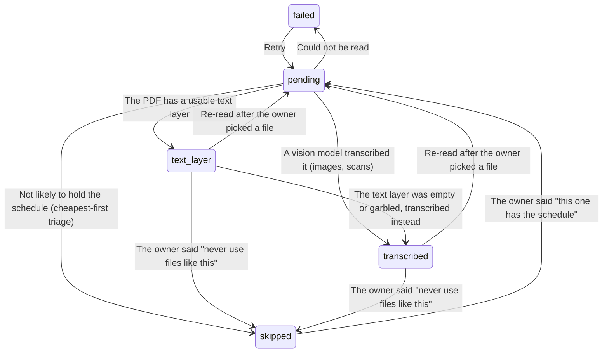
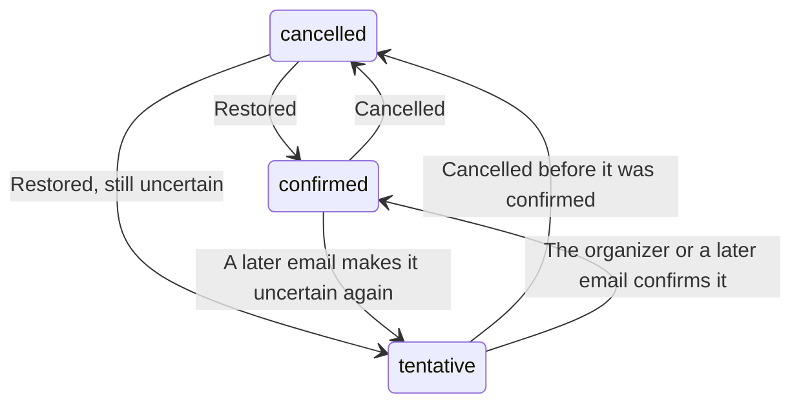
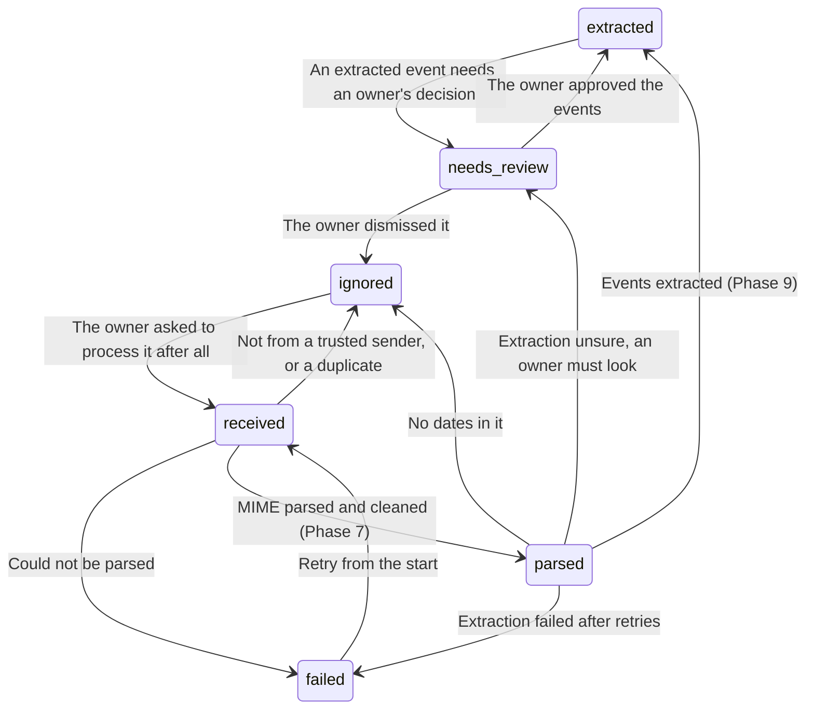
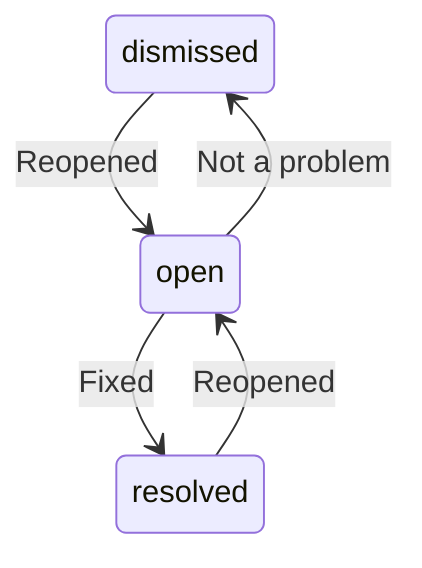

# State machines

Status: added 2026-11-20 (D24). This page lists every place in Feedcal where something has states and moves between them.

## The rule

**The database is the single source of truth.** Two tables define the legal moves: `private.state_machines` and `private.state_transitions`. One trigger, `private.enforce_transition`, refuses any other move on UPDATE. Its error names the allowed moves, for example:

> message_status cannot move from "parsed" to "received". Allowed from "parsed": extracted, failed, ignored, needs_review.

Inserts aren't restricted: a row may start in any valid state.

**To change a machine:**
1. Write a migration that changes `private.state_transitions`.
2. Run `npm run db:states`. It regenerates `packages/shared/src/state-machines.generated.ts` and the diagrams below.
3. Add a label for any new state in `packages/shared/src/state-machines.ts`. TypeScript fails until you do.

CI fails if the generated files are stale.

**In code:** `canTransition(machine, from, to)`, `nextStates(machine, from)` and `stateLabel(machine, state)` from `@feedcal/shared`. Agents and scripts can read every rule from `public.state_machines()`; it holds no user data.

## Every machine in the app

| # | Machine | Lives in | How it's handled |
|---|---|---|---|
| 1 | Event status | `events.status` | **Enforced** (below). Also, any change a subscriber can see raises `SEQUENCE` automatically (`private.events_bump_sequence`). Calendar apps use SEQUENCE to decide whether an edit is newer; before this, nothing raised it. |
| 1b | Event visibility | `events.published` | A draft (false) is never in a feed or on a page. Publishing and unpublishing are free and don't change SEQUENCE: subscribed calendars mirror the whole feed, so an unpublished event simply leaves it. |
| 2 | Message pipeline | `messages.status` | **Enforced** (below). Phases 6–9 build on it. |
| 3 | Attachment pipeline | `attachments.status` | **Enforced** (below). Phase 8 builds on it. `chosen` is a separate flag ("this one has the schedule"). |
| 4 | Report status | `reports.status` | **Enforced** (below). |
| 5 | Account deletion | `profiles.deleted_at` + time | `active` → `scheduled_for_deletion` (`request_account_deletion`) → due once the grace period passes (`due_account_deletions`) → purged (the `delete-accounts` function deletes the row). Cancelling returns it to `active`. The grace period is defined once, in `private.deletion_grace()`. The account page reads the state and date from `public.account_status()`. |
| 6 | Feed visibility | `feeds.visibility` | Every move is allowed. Side effect: becoming `unlisted` adds a random slug suffix (`private.feeds_unlisted_slug`). Only owners can change it (RLS). |
| 7 | Feed link | `feeds.feed_token_hash` + Vault | One state, "current". `rotate_feed_token()` replaces it, and the old link dies at once. The share kit shows a notice after a rotation (`?rotated=1`, redirect after POST). |
| 8 | Sign-in link | Supabase Auth | sent → used, or expired after 15 minutes. Owned by Supabase, not our code; we only render the outcomes (`/auth/confirm`). |

## Enforced machines (generated from the database; don't edit by hand)

<!-- BEGIN GENERATED: npm run db:states -->

### `attachment_status` — `attachments.status`

An attachment's text: from the PDF text layer, or a vision transcription, or skipped.

| From | To | When |
|---|---|---|
| `failed` | `pending` | Retry |
| `pending` | `failed` | Could not be read |
| `pending` | `skipped` | Not likely to hold the schedule (cheapest-first triage) |
| `pending` | `text_layer` | The PDF has a usable text layer |
| `pending` | `transcribed` | A vision model transcribed it (images, scans) |
| `skipped` | `pending` | The owner said "this one has the schedule" |
| `text_layer` | `pending` | Re-read after the owner picked a file |
| `text_layer` | `skipped` | The owner said "never use files like this" |
| `text_layer` | `transcribed` | The text layer was empty or garbled; transcribed instead |
| `transcribed` | `pending` | Re-read after the owner picked a file |
| `transcribed` | `skipped` | The owner said "never use files like this" |

### `event_status` — `events.status`

Whether an event is happening. Cancelled events stay in feeds for 30 days as STATUS:CANCELLED so calendars remove them.

| From | To | When |
|---|---|---|
| `cancelled` | `confirmed` | Restored |
| `cancelled` | `tentative` | Restored, still uncertain |
| `confirmed` | `cancelled` | Cancelled |
| `confirmed` | `tentative` | A later email makes it uncertain again |
| `tentative` | `cancelled` | Cancelled before it was confirmed |
| `tentative` | `confirmed` | The organizer or a later email confirms it |

### `message_status` — `messages.status`

A forwarded email moving through intake: parse, extract events, then review.

| From | To | When |
|---|---|---|
| `extracted` | `needs_review` | An extracted event needs an owner's decision |
| `failed` | `received` | Retry from the start |
| `ignored` | `received` | The owner asked to process it after all |
| `needs_review` | `extracted` | The owner approved the events |
| `needs_review` | `ignored` | The owner dismissed it |
| `parsed` | `extracted` | Events extracted (Phase 9) |
| `parsed` | `failed` | Extraction failed after retries |
| `parsed` | `ignored` | No dates in it |
| `parsed` | `needs_review` | Extraction unsure; an owner must look |
| `received` | `failed` | Could not be parsed |
| `received` | `ignored` | Not from a trusted sender, or a duplicate |
| `received` | `parsed` | MIME parsed and cleaned (Phase 7) |

### `report_status` — `reports.status`

A subscriber's "Report a problem" handled by the feed's owners and editors.

| From | To | When |
|---|---|---|
| `dismissed` | `open` | Reopened |
| `open` | `dismissed` | Not a problem |
| `open` | `resolved` | Fixed |
| `resolved` | `open` | Reopened |

<!-- END GENERATED -->
